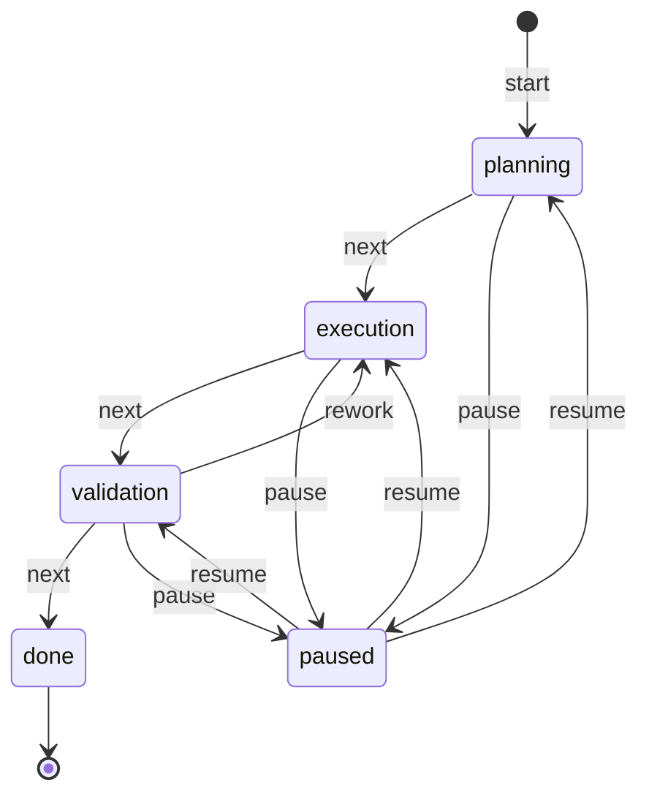

# Token accounting and context limits

The agent counts tokens on every turn and can refuse to send a request that would
overflow the model's context window. For each user message it tracks:

* **request** — tokens for the current user message alone;
* **history** — tokens for the whole prior dialog (system prompt + all past turns);
* **context** — the full stack actually sent to the model (history + request);
* **reply** — tokens the model spent on its answer.

When the provider reports token `usage` (OpenAI does; some local servers do not)
the authoritative numbers replace the local estimates; otherwise a deterministic
`chars/4` estimate plus a per-message overhead is used, so counting always works
offline and for any provider.

* `Session.chat_with_details()` returns a `ChatResult` with a `TokenUsage`
  snapshot; `Session.last_usage` holds the most recent turn's numbers.
* The interactive CLI and one-shot agent calls print `[tokens ...]` to stderr
  after each reply.
* If the assembled context exceeds the model's `context_window`, a
  `ContextOverflowError` is raised **before** anything is sent — the caller must
  trim history or start a new session.
* Some providers impose a **hard per-request token ceiling** from the account
  tier (e.g. Groq's `on_demand` tier refuses any single request above its TPM
  cap even with a full rate-limit bucket — retrying can never help). Set
  `max_request_tokens:` per model (or `LLM_MAX_REQUEST_TOKENS` globally) and the
  agent blocks such requests up front with a `ContextTooLargeError`. A provider
  HTTP 413 whose body reports `Requested > Limit` is also mapped to this error.

Two independent budgets apply — the effective ceiling is the smaller of the
model's `context_window` and the account `max_request_tokens`:

* model window → `context_window` (`ContextOverflowError`);
* account per-request size cap → `max_request_tokens` (`ContextTooLargeError`).

Set both per model in `data/models.yaml` (`context_window:`,
`max_request_tokens:`) or globally via `LLM_CONTEXT_WINDOW` /
`LLM_MAX_REQUEST_TOKENS` (see `.env.example`).

```bash
# Interactive chat; token stats appear on stderr after each reply
.venv/bin/python -m llm_bot --agent assistant

# Offline demo: short vs long vs account-limit vs overflowing dialogs, token
# growth and the failures, using a fake transport (no API key needed)
.venv/bin/python scripts/token_demo.py
.venv/bin/python scripts/token_demo.py --context-window 400 --max-request-tokens 200
```

## Context strategies (without summary)

Besides rolling-summary compression, you can manage context with one of three
**pluggable strategies** that never build an LLM summary. They share a single
code path (`Session` + `Agent.build_messages`) and are selected per-agent (in
`data/agents.yaml`) or per-session via `--strategy`:

| Key        | Strategy                | What is sent to the model                     | Loss? |
|------------|-------------------------|-----------------------------------------------|-------|
| `sliding`  | Sliding Window          | Only the last `context_window_messages` msgs  | early details drop out of the reply |
| `facts`    | Sticky Facts / KV memory| A durable `facts` block + last N messages     | none (memory keeps details) |
| `branching`| Branching               | Full history of the active branch             | none (per branch) |

All three keep the **full** history on disk (in `data/sessions/*.json`); they only
trim what reaches the model. Nothing is deleted from persistent storage.

**Sliding window** — cheap and predictable; pick a `context_window_messages` that
fits the task:
```bash
python -m llm_bot --agent assistant --strategy sliding --window-messages 8
```

**Sticky facts** — the agent maintains a key/value `facts` block (goal, constraints,
preferences, decisions, agreements), refreshed after every turn by a small LLM call,
and sends `facts` + the last N messages. Details survive a small window at the cost
of extra tokens for the refresh:
```bash
python -m llm_bot --agent assistant --strategy facts --window-messages 8
```

**Branching** — fork the dialog into independent lines. `/branch <name>` snapshots
the current position as an automatic checkpoint and starts a new branch; `/switch`
moves between branches; `/branches` lists them:
```
> /branch web          # создаст ветку 'web' от текущей точки (checkpoint автоматически)
> В ТЗ добавить веб-интерфейс
> /switch main         # вернуться к основной линии
```
Each branch keeps its own full history and persists across restarts.

Config example (`data/agents.yaml`):
```yaml
assistant-sliding:
  model: openai-gpt4o
  system_prompt: "Ты полезный помощник."
  context_strategy: sliding
  context_window_messages: 8
```

A reproducible comparison on a shared "ТЗ" scenario is available:
```bash
python scripts/compare_context_strategies.py
```
and its analysis is in [`results/context_strategies_analysis.md`](../results/context_strategies_analysis.md).

## Task state machine

The work on a task is formalized as a **finite-state machine**
([`task_state.py`](../llm_bot/task_state.py)) with three axes:

* **stage** — the pipeline `planning → execution → validation → done`
  enforced by a transition table (`done` is terminal; there are **no**
  `planning → done` / `execution → done` edges, so a final without validation
  is impossible even for the model);
* **step** — what is being done right now;
* **expected_action** — what should happen next.

`paused` is a first-class state reachable from *any* non-terminal stage; it
remembers the originating stage, so resume returns the machine exactly where
it was.



Two ways to drive the machine:

* **auto-detect** (default) — after every turn a small LLM call recognizes a
  task being set from the dialog, stage hints, and pause/resume phrases
  (same technique as memory auto-extraction). A legal hint moves the machine
  *exactly* to the hinted stage (`move_to`); a classifier failure never
  breaks the turn.
* **manual** — slash-commands take priority over auto-detection:

```text
/task                      — status: stage, pause, step, expected action
/task start <описание>     — start a task (stage = planning)
/task step <текст>         — set the current step
/task action <текст>       — set the expected action
/task next [заметка]       — advance to the next pipeline stage
/task rework [причина]     — validation → execution (fix defects)
/task pause                — pause from any stage
/task resume               — continue (no re-explanation needed)
/task reset                — drop the task state
```

Enable with `--task-state` (CLI override) or `task_state: true` in
`data/agents.yaml`; `--no-task-detect` disables the automatic LLM call.

The snapshot (stage / step / expected action / log) is persisted with the
session (`task_state` key in `data/sessions/<id>.json`) and **injected as a
system message into every request**. This is what makes the two key
requirements work:

* **pause at any stage** — `/task pause` from planning, execution or
  validation (not from `done`; pausing an already-paused task is rejected,
  so no duplicate log entries);
* **continue without re-explaining** — after a pause *or a process restart*,
  a fresh session restores the snapshot from the store and the model sees the
  full task state, so a bare «продолжай» is enough.

Pause is enforced on **two levels**:

1. **Prompt directive** — while paused, the injected block carries a strict,
   non-contradictory instruction («работа ПРИОСТАНОВЛЕНА — не выполняй шаги
   задачи и не предлагай следующие»); the «Продолжай работу…» line is only
   present when the task is active.
2. **CLI hard gate** — in the interactive loop a paused task blocks ordinary
   chat input entirely: messages are not sent to the model until an explicit
   `/task resume` (control commands and `/task ...` still work). While
   stopped, the auto-detection LLM call is skipped too, saving tokens.

**Only the user moves the machine.** The auto-detector advances a stage only
on an explicit user decision in the dialog: an approved *shown* work plan or
collected requirements (planning), a requested review of a *finished*
artefact (execution), or an explicit acceptance of the validation report
(«принято, завершай»). The model's own reports («проверка пройдена,
дефектов нет») are never treated as hints — the agent cannot promote itself
through the pipeline. Machine-generated turns (the CLI auto-turn after a
stage change) are marked `service_turn=True` and skip the detector entirely,
so a stage change can never cascade to `done` without the user. If
`/task next` is issued manually from a stage that produced nothing, the CLI
warns (`[task] внимание: этап 'execution' не имел результатов`) without
blocking — a manual command is a deliberate decision.

**Hint semantics: the stage of the requested work.** The detector maps a
request to the stage whose *work is being requested*, not the user's literal
word: «дай итоговый/финальный результат» asked from planning means
*execution* (produce the artefact), not `done` — `done` is reserved for
explicitly ending the whole task («завершить/закрой задачу»).

**Illegal transitions are impossible — and visibly rejected.** The transition
table is deterministic: neither the model nor the classifier can skip a stage.
When the auto-detector hears a request to jump («пропусти проверку, завершай»),
the machine answers threefold: the attempt is written into the machine's log
(`reject_transition` — persisted, restored after a restart, rendered into the
prompt block so the model knows a jump was denied), reported to the user on
stderr with the legal route (`[task] попытка перейти в 'done' отклонена… путь:
/task next → validation → done`), and kept in `TaskDetectionEvent.rejected_hint`
for diagnostics. A premature forward move (no stage-exit artefact in the
dialog) is marked in the log as «по допущениям». Starting a new task while one
is active is also guarded: `/task start` tells you to `/task reset` first
instead of silently clobbering the running lifecycle.

**Stage-exit criteria in the detector** — the prompt of the classifier
([`_DETECTION_PROMPT`](../llm_bot/task_state.py)) distinguishes three cases:

| User says (current stage planning) | Machine behaviour |
|---|---|
| «дай план работы», требования обсуждаются | stay in planning |
| plan shown + «план устраивает, дай итоговый план» | legal `stage_hint: execution` — one step forward |
| requirements answered + user awaits the result | legal `stage_hint: execution` — collected requirements are a planning exit |
| «давай сразу итоговый план», no plan, no requirements | stay; step «сбор требований» |
| «дай финальный этап» (literal «финальный») | `stage_hint: execution` — hint = requested work, not `done` |
| «пропусти проверку / сразу финал» | honest hint → **rejected** (no edge) |

**Stages change what the model actually does** — each stage injects its own
behaviour directive ([`_STAGE_DIRECTIVES`](../llm_bot/task_state.py)):
`planning` → "план работы, не итоговый артефакт; когда требования собраны —
резюмируй их и предложи /task next, не выдавая результат в этой же реплике;
если просят результат без собранных требований — доуточни или предложи
/task next по допущениям"; `execution` → "реализуй текущий шаг, результат —
артефакт"; `validation` → "проверяй по критериям; дефекты — предлагай
/task rework"; `done` → "только итоговая сводка". Advancing a stage also
auto-fills `expected_action` with a stage-typical default (a user-set action
is kept), so after `/task next` the model immediately knows what is expected
next.

**Rework loop** — validation may find defects: `/task rework` (or a «переделай»
phrase recognized by the detector) legally moves `validation → execution`
without touching the done edge. `/task next` from validation still means
"проверка пройдена, завершаем" — the two edges are distinct.

**Auto-turn on stage change** — `/task start`, `/task next`, `/task rework`
and `/task resume` immediately send the model one service turn («этап задачи
изменился на … — действуй по состоянию задачи», see
[`_task_auto_turn`](../llm_bot/cli.py)), so the stage directive takes effect
*right away* instead of waiting for the user's next message. The same holds
for **auto-detected** stage changes: when a reply moves the machine (G8,
[`_auto_turn_after_detection`](../llm_bot/cli.py)), the model acts on the new
stage at once — «дай финальный этап» produces the requirement summary *and*
the artefact in one go, instead of lagging one user turn behind. The reply is
printed in the chat; an `LLMError` is reported to stderr without aborting the
command. `/task pause` deliberately sends **no** auto-turn (the model is never
prompted while paused).

Diagnostics: `session.task_state`, `session.task_events`,
`session.total_task_tokens` (token spend of the detection calls).

Verification on a real model: `python scripts/verify_task_state.py`
(report: [`results/task_state_verification.md`](../results/task_state_verification.md)).

## Invariants (hard constraints)

Invariants are **hard constraints the assistant must never violate** — the
chosen architecture, accepted technical decisions, stack limits, business
rules. They follow the project doctrine: explicit *owner configuration*, NOT
memory — nothing from the dialog ever becomes an invariant automatically, and
the dialog can never remove a global invariant.

Create the file from the template:

```bash
cp invariants.example.yaml data/invariants.yaml
```

Storage is separate from the dialog by construction:

* **global** invariants live in `data/invariants.yaml` (`kind_labels` is an
  optional `kind → label` section; the code knows no fixed category taxonomy —
  add new kinds without code changes);
* **session-scoped** invariants (added via `/invariant add`) are persisted
  under the `invariants` key of `data/sessions/<id>.json` — never in the
  message history.

Enforcement is three-level, mirroring the task-pause design:

1. **Prompt directive (always)** — the rendered block (id, kind, statement,
   rationale + a **strengthened refusal protocol** in ALL CAPS with an
   explicit pre-check step: check → refuse → name invariant → explain
   rationale → offer alternative; no workarounds) is injected as the FIRST
   prefix system message on every request (ahead of memory and task state),
   so the model explicitly reasons within the constraints. Additionally, a
   **recency-bias footer** (`render_footer()`) — a short reminder
   "НАПОМИНАНИЕ: check invariants before answering" — is injected as a
   system message immediately before the current user message, so the model
   sees the constraint at the point of maximum attention.
2. **Code gate (pre-flight)** — `forbidden_patterns` (case-insensitive regex
   per invariant) are matched against the user message BEFORE the request is
   sent. A match raises `InvariantViolationError` with a ready refusal naming
   the invariant, its rationale and how to proceed: the request never reaches
   the model, no tokens are spent, and the history is untouched. A conflicting
   one-shot request exits with code **3**.
3. **Reply audit (post-flight, always on)** — one small LLM call after each
   reply checks compliance (detection only, the reply is never rewritten).
   The audit receives the **full turn context** (user message + assistant
   reply) so it can recognize whether the user's request was provocative.
   By default this is a **hard gate**: a violating reply is refused
   (`InvariantViolationError` raised), the assistant reply and user message
   are rolled back from history, and the persisted state is updated. Use
   `--audit-invariants-warn` to downgrade to a warning-only mode (the reply
   is shown but the violation is logged to stderr). The audit is skipped
   entirely when the registry is empty (no invariants wired).

```bash
python -m llm_bot --agent assistant                       # auto-loads data/invariants.yaml
python -m llm_bot --list-invariants                       # inspect global invariants
python -m llm_bot --agent assistant --no-invariants       # disable for one run
python -m llm_bot --agent assistant --audit-invariants-warn  # warn-only audit mode
python -m llm_bot --agent assistant \
  --invariants-file path/to/rules.yaml                    # custom location
```

Inside the interactive chat:

```text
/invariants                     — list the registry (global + session)
/invariant add <тип> <текст>    — add a session-scoped invariant (persisted)
/invariant drop <id>            — remove a session-scoped one (global are protected)
```

When a request conflicts with an invariant, the refusal explains itself: it
names the invariant (id and kind), states the rule, gives the rationale and
asks the user to reformulate or propose alternatives within the constraint —
whether the refusal came from the deterministic gate or from the model
following the prompt protocol.

Programmatic use:

```python
from llm_bot import InvariantRegistry

registry = InvariantRegistry(kind_labels={"stack": "ограничение по стеку"})
violated = registry.check_request("давай перепишем на Django")
if violated is not None:
    print(violated.refusal_text("django"))   # deterministic refusal text
print(registry.render_prompt_block())        # system-prompt fragment
print(registry.render_footer())              # recency-bias reminder ("" if empty)
```

## Context compression (rolling summary)

For long conversations, resending the *whole* history every turn costs tokens and
eventually overflows the context window. Enable **compression** on a session to
fold older turns into a short running summary that is injected at the front of each
request instead of the full old dialog:

* **keep-last (N)** — the most recent N messages stay verbatim, so fresh context
  is exact;
* **block size (M)** — when the live history exceeds M messages, the oldest part
  that falls outside the recent window is folded into the summary. The summary is
  updated **incrementally** (existing summary + new block only), so compressing is
  cheap.

The summary is stored separately in the session file and survives restarts.
Compression is **off by default** and can be enabled **per agent** in
`data/agents.yaml`:

```yaml
agents:
  assistant:
    model: openai-gpt4o
    system_prompt: "Ты помощник."
    keep_last_messages: 10            # N — recent messages kept verbatim
    summarize_messages_threshold: 20  # M — fold the oldest part once history exceeds this
    max_summary_tokens: 500           # optional: hard cap on summary size (tokens)
    # max_summary_ratio: 0.25         # optional: cap summary as a share of the context window
```

When both fields are set, every session created for that agent compresses its
history automatically. Agents without them stay uncompressed. You can still
override/force it programmatically via `make_session(..., compression=...)`:

```python
from llm_bot import CompressionSettings
from llm_bot.factory import make_session

session = make_session(
    "s1", "assistant",
    model_store=model_store, agent_store=agent_store, session_store=session_store,
    transport=transport,
    compression=CompressionSettings(keep_last=10, block_size=20),
)
```

Session attributes: `session.summary` (the running summary),
`session.compression_enabled`, and compression statistics:
`session.compression_events` (list of `CompressionEvent`), `session.total_compressions`,
`session.total_messages_folded`, `session.last_compression_event`.

**Limiting the summary size.** A running summary can grow large over a long
conversation. To keep it from crowding out the context window, cap its size with
`max_summary_tokens` (hard cap, applied in code) and/or `max_summary_ratio`
(soft cap as a fraction of the model's context window; default `0.3`). The
effective budget is the smaller of the two, and the summary is **truncated in
code** to guarantee it fits. The budget is also passed to the summarizer as a
soft instruction ("keep it brief") so the model usually stays under the cap
without truncation.

**Service message.** The CLI prints a line to **stderr** whenever history is folded,
with the token impact and history-size change:

```
[compression] свёрнуто 4 сообщений, -22 токенов контекста, история 8->4, summary 2 симв., (всего сжатий: 3)
```

Programmatic callers can pass an `on_compress` callback to `make_session(...)` to be
notified of each fold:

```python
from llm_bot import CompressionEvent

def on_compress(e: CompressionEvent) -> None:
    print(f"folded {e.messages_folded} msgs, saved ~{e.folded_tokens} tokens")

session = make_session(..., on_compress=on_compress)
```

> **Cost/quality tradeoff.** Compression saves prompt tokens (recent real runs:
> ~39% on a 24-fact dialog even after charging the summarization calls), but a
> lossy summarizer can drop some older facts. See
> [`results/compression_analysis.md`](../results/compression_analysis.md) and run the
> reproducible experiment:
>
> ```bash
> python scripts/compare_compression.py                   # lossless (retention 1.0)
> python scripts/compare_compression.py --retention 0.6   # lossy summarizer
> ```
